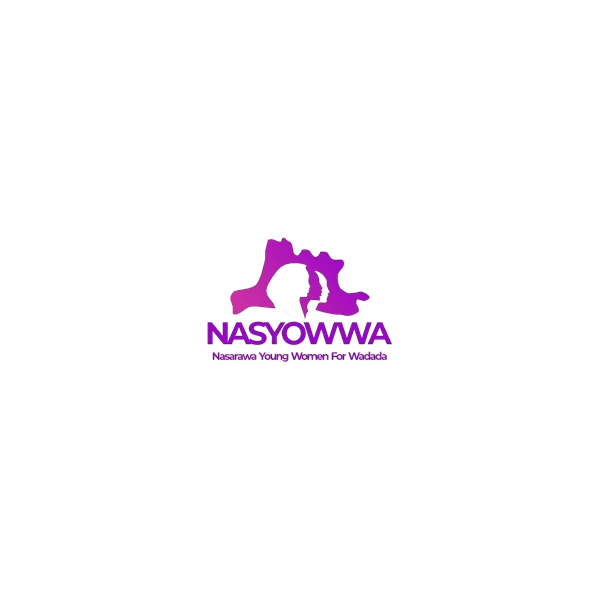

# NASYOWWA Landing Page (Wadada Youth Connect)



A modern, responsive, and professional landing page for **Nasarawa Young Women for Wadada (NASYOWWA)**. This volunteer-driven movement is established to mobilise, educate, organise, and empower young women across the 13 Local Government Areas in Nasarawa State in support of Senator Ahmed Wadada Aliyu's vision for an inclusive and prosperous state.

## 🚀 Features

- **Modern & Responsive UI**: Fully responsive design tailored for mobile, tablet, and desktop experiences.
- **Smooth Animations**: Engaging and subtle animations using Framer Motion to enhance user experience.
- **Component-Driven**: Built with highly reusable components using React and Radix UI primitives (via shadcn/ui).
- **Type-Safe**: Developed entirely in TypeScript for robust and maintainable code.
- **Fast Development**: Powered by Vite for instant server starts and lightning-fast HMR (Hot Module Replacement).
- **Type-Safe Routing**: Utilizes TanStack Router for robust, developer-friendly navigation.

## 🛠️ Tech Stack

- **Framework**: [React 19](https://react.dev/)
- **Build Tool**: [Vite](https://vitejs.dev/)
- **Styling**: [Tailwind CSS v4](https://tailwindcss.com/)
- **UI Components**: [shadcn/ui](https://ui.shadcn.com/) & [Radix UI](https://www.radix-ui.com/)
- **Routing**: [TanStack Router](https://tanstack.com/router/latest)
- **Animations**: [Framer Motion](https://www.framer.com/motion/)
- **Icons**: [Lucide React](https://lucide.dev/)

## 📂 Project Structure

```text
├── public/                 # Static assets (logos, icons, etc.)
├── src/                    # Application source code
│   ├── assets/             # Images and global styles
│   ├── components/         # Reusable UI components
│   │   ├── site/           # Page-specific sections (Hero, Navbar, Footer, etc.)
│   │   └── ui/             # Core UI components (shadcn/ui)
│   ├── data/               # Static site content and configuration
│   ├── hooks/              # Custom React hooks
│   ├── lib/                # Utility functions and helpers
│   ├── routes/             # TanStack Router page definitions
│   └── styles.css          # Global Tailwind CSS entry
├── .lovable/               # Lovable configuration
├── package.json            # Project dependencies and scripts
├── tailwind.config.ts      # Tailwind CSS configuration
└── vite.config.ts          # Vite configuration
```

## 💻 Getting Started

### Prerequisites

Make sure you have [Node.js](https://nodejs.org/) installed on your machine.

### Installation

1. Clone the repository and navigate into the project directory:
   ```bash
   git clone <repository-url>
   cd wadada-youth-connect
   ```

2. Install the dependencies:
   ```bash
   npm install
   ```

3. Start the development server:
   ```bash
   npm run dev
   ```

4. Open your browser and visit `http://localhost:5173` to view the application.

### Building for Production

To create a production-ready build, run:
```bash
npm run build
```
The optimized assets will be generated in the `dist` folder, which can be deployed to any static hosting service (Vercel, Netlify, GitHub Pages, etc.).

## 🎨 Design System

The application design is guided by principles of elegance, community-focus, and professionalism:
- **Color Palette**: Highlights the primary `#BC00BA` color on a clean white background.
- **Typography**: Clean, modern fonts configured globally.
- **Layouts**: Thoughtfully spaced cards with subtle drop shadows to convey trustworthiness and premium quality.

## 📄 License

This project is proprietary and intended for the NASYOWWA organization. All rights reserved.
