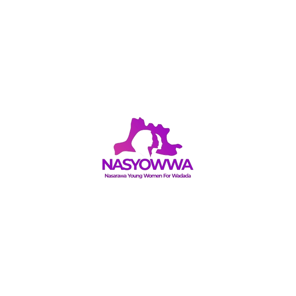

# Nasarawa Progressive Young Women (NAS-PYW)

Theme: **Mobilising Nasarawa Young Women for Inclusive Leadership and Democratic Participation**



A modern, responsive, and professional web platform for **Nasarawa Progressive Young Women (NAS-PYW)**. Affiliated with the All Progressives Congress (APC) in Nasarawa State, North Central Nigeria, the group brings young women into politics, democratic processes, and governance as informed participants, decision-makers, and leaders across all 13 Local Government Areas.

## Key Content Sections

- **About NAS-PYW**: Background on inclusion, leadership development, and grassroots engagement across the 13 LGAs.
- **Vision & Mission**: Clear vision and mission within the APC in Nasarawa State.
- **Objectives**: All 8 strategic objectives covering political participation, offices/appointments, grassroots structures, political education, and accountability.
- **Core Values**: Participation, Inclusion, Integrity, Accountability, Leadership, Unity, and Service.
- **Who We Engage**: Young women aged 18–40, students, graduates, professionals, entrepreneurs, community volunteers, and experienced mentors.
- **Programmes and Activities**: 7 action areas including Grassroots Mobilisation, Political Education, Leadership Development, Policy Engagement, Civic Service, Media Engagement, and Stakeholder Partnerships.
- **Organisational Structure**: Governance hierarchy across Grand Patron/Patrons, Convener / Co-convener, State Executive Committee, LGA Coordinators, Ward Coordinators, and Community Volunteers.
- **Expected Outcomes**: Measurable impact across grassroots political participation.
- **Sustainability and Long-Term Commitment**: Continuing platform beyond individual electoral cycles.
- **Our Commitment**: *"Democracy works best when women are part of it. We are building a network of young women who vote, lead, speak up and serve."*
- **Join NAS-PYW**: Official interactive membership registration with Nasarawa State 13 LGAs and wards.

## Tech Stack

- **Framework**: [React 19](https://react.dev/)
- **Build Tool**: [Vite](https://vitejs.dev/)
- **Styling**: [Tailwind CSS v4](https://tailwindcss.com/)
- **UI Components**: Radix UI
- **Routing**: [TanStack Router](https://tanstack.com/router/latest)
- **Animations**: [Framer Motion](https://www.framer.com/motion/)
- **Icons**: [Lucide React](https://lucide.dev/)

## Getting Started

### Prerequisites

Make sure you have [Node.js](https://nodejs.org/) installed on your machine.

### Installation

1. Install dependencies:
   ```bash
   npm install
   ```

2. Start the development server:
   ```bash
   npm run dev
   ```

3. Build for production:
   ```bash
   npm run build
   ```

## License

This project is proprietary and intended for Nasarawa Progressive Young Women (NAS-PYW). All rights reserved.
